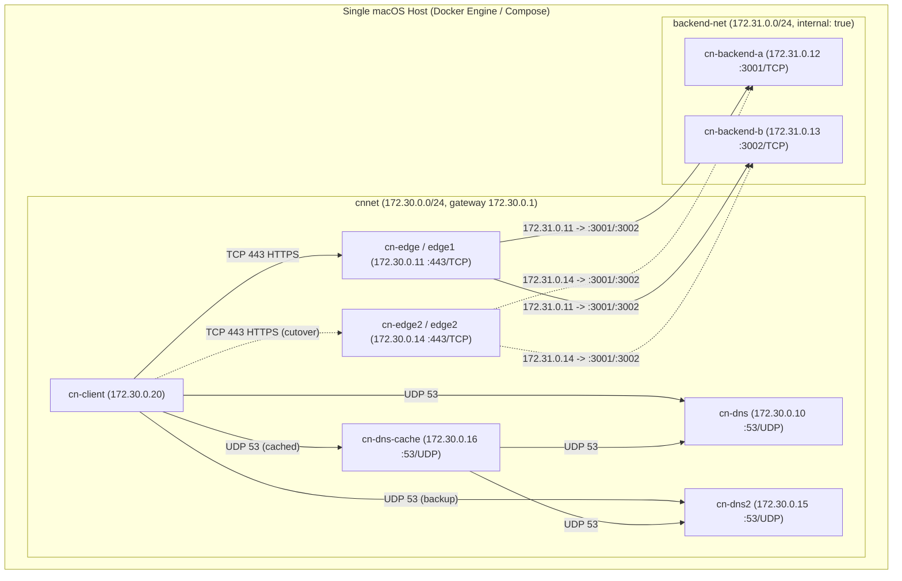

# Phase 2 Architecture & IP Inventory (Team Climber)

> **Implementation note:** All service roles run as Docker containers on a **single macOS host**, each representing a machine role. The IP addresses below are Docker bridge-network IPs, not separate physical Macs.

## Network Topology

Two Docker bridge networks segment client-facing traffic from backend traffic:

- **`cnnet` (`172.30.0.0/24`, gateway `172.30.0.1`):** Client, DNS resolvers (`dns`, `dns2`, `dns-cache`), and Nginx edge servers (`edge`, `edge2`).
- **`backend-net` (`172.31.0.0/24`, gateway `172.31.0.1`, `internal: true`):** Isolated backend network containing `backend-a`, `backend-b`, and the backend-facing NICs of `edge` and `edge2`. `cn-client` has no route to `backend-net` and cannot reach ports `3001`/`3002` directly.

*(Mermaid source saved in [architecture-phase2.mmd](file:///Users/sahilchand/cn-phase1/01-architecture/architecture-phase2.mmd).)*

## Container / Service Inventory

| Role | Container | Service | Network(s) | IP Address(es) | Port / Proto | Purpose |
| :--- | :--- | :--- | :--- | :--- | :--- | :--- |
| Client | `cn-client` | `client` | `cnnet` | `172.30.0.20` | — | Runs `dig`, `curl`, `nc`, `openssl`, `diagnose.sh` |
| Primary DNS | `cn-dns` | `dns` | `cnnet` | `172.30.0.10` | `53/UDP` | Authoritative `dnsmasq` for `app.team1.test` |
| Backup DNS | `cn-dns2` | `dns2` | `cnnet` | `172.30.0.15` | `53/UDP` | Redundant `dnsmasq` with identical records |
| Caching DNS | `cn-dns-cache` | `dns-cache` | `cnnet` | `172.30.0.16` | `53/UDP` | Caching `dnsmasq` forwarder (`cache-size=1000`) |
| Primary Edge | `cn-edge` | `edge` | `cnnet`, `backend-net` | `172.30.0.11`, `172.31.0.11` | `443/TCP` | Nginx TLS termination, reverse proxy, LB (`X-Edge: edge1`) |
| Standby Edge | `cn-edge2` | `edge2` | `cnnet`, `backend-net` | `172.30.0.14`, `172.31.0.14` | `443/TCP` | Standby Nginx edge for DNS cutover (`X-Edge: edge2`) |
| Backend A | `cn-backend-a` | `backend-a` | `backend-net` (internal) | `172.31.0.12` | `3001/TCP` | Python HTTP server A (`X-Backend: A`) |
| Backend B | `cn-backend-b` | `backend-b` | `backend-net` (internal) | `172.31.0.13` | `3002/TCP` | Python HTTP server B (`X-Backend: B`) |
